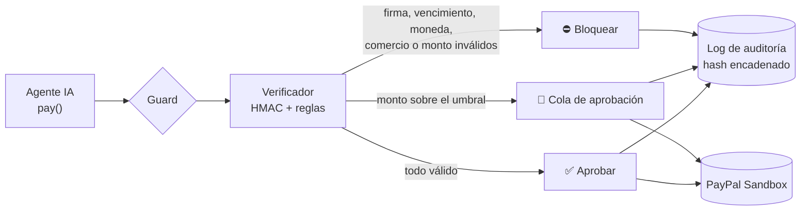

<div align="center">

```
  AI Agent                                                                  PayPal
  ┌─────────┐   pay()   ┌──────────────────────────────┐   approve    ┌──────────────┐
  │  🤖     │ ────────► │  GUARD  ►  VERIFIER (HMAC)   │ ───────────► │ Sandbox Order│
  └─────────┘           └──────────┬───────────────────┘              └──────────────┘
                                   │ block / needs human
                                   ▼
                        🔗 Audit log (hash-chained)
```

# 🛡️ Safeizi

### La capa de seguridad para los pagos de agentes de IA

*Los agentes de IA ya compran por nosotros, pero nadie quiere darles una tarjeta de crédito.*
**Safeizi se coloca entre el agente y PayPal y garantiza que solo se pague lo que el humano autorizó.**

<br/>


</div>

<br/>

## 📌 Tabla de contenido

- [🌐 Sobre el proyecto](#-sobre-el-proyecto)
- [🎯 Situación problemática](#-situación-problemática)
- [✨ Funcionalidades](#-funcionalidades)
- [📐 Arquitectura](#-arquitectura)
- [🔀 Flujo de una decisión](#-flujo-de-una-decisión)
- [🧩 Componentes de la solución](#-componentes-de-la-solución)
- [🔧 Tecnologías utilizadas](#-tecnologías-utilizadas)
- [🚀 Instalación y ejecución](#-instalación-y-ejecución)
- [🔐 Seguridad y reglas del verificador](#-seguridad-y-reglas-del-verificador)
- [🧪 Red Team y validación](#-red-team-y-validación)
- [⚠️ Limitaciones honestas](#️-limitaciones-honestas)
- [🧭 Roadmap](#-roadmap)
- [👤 Autor](#-autor)
- [📄 Licencia](#-licencia)

<br/>

## 🌐 Sobre el proyecto

**Safeizi** es un firewall de pagos para agentes de IA. El usuario firma un **Mandato** con sus reglas de gasto (límites, comercios permitidos, moneda y vencimiento) y, a partir de ahí, cualquier pago que pida un agente pasa obligatoriamente por el **Guard**. Un **Verificador determinista** (reglas fijas + firma HMAC) decide si el pago se **bloquea**, se **envía a aprobación humana** o se **aprueba** y se crea como orden en **PayPal Sandbox**.

Cada decisión queda registrada en un **log de auditoría encadenado por hash**, de modo que cualquier alteración posterior es detectable.

> 💡 La decisión del Guard **no depende del agente ni del LLM** que se use: aunque el agente esté comprometido o sufra una inyección de prompt, solo puede pedir pagar, nunca pagar directamente.

### Impacto de la solución

| Dimensión | Aporte |
|---|---|
| 🔒 **Seguridad** | El agente nunca toca credenciales de pago; solo puede solicitar al Guard |
| 🧾 **Confianza** | Cada decisión es verificable gracias al log con cadena de hashes |
| 🙋 **Control humano** | Los pagos grandes pasan por una cola de aprobación antes de llegar a PayPal |
| 🧪 **Verificabilidad** | El modo Red Team mide cuántos ataques bloquea el firewall |

<br/>

## 🎯 Situación problemática

| ❌ Riesgos sin una capa de control | ✅ Solución propuesta |
|---|---|
| El agente podría pagar a un destinatario distinto al autorizado | Lista blanca de comercios dentro del mandato firmado |
| Un agente con inyección de prompt puede inflar el monto | Tope de monto por pago verificado de forma determinista |
| Cambios de moneda inesperados | Validación estricta de la moneda del mandato |
| Edición de las reglas de gasto por un tercero | Mandato firmado con HMAC-SHA256: cualquier edición lo invalida |
| Reutilización de autorizaciones antiguas | Vencimiento obligatorio del mandato |
| Nadie puede demostrar qué se decidió ni cuándo | Auditoría con hashes encadenados y verificación de integridad en la UI |
| Pagos de alto valor sin supervisión | Umbral de aprobación humana con cola de aprobación |

<br/>

## ✨ Funcionalidades

<table>
<tr>
<td width="50%" valign="top">

### 🛡️ Núcleo de seguridad
- **Mandato firmado:** HMAC-SHA256 sobre las reglas de gasto
- **Verificador:** firma, vencimiento, moneda, lista de comercios, tope de monto y umbral de aprobación humana
- **Log de auditoría:** cada entrada incluye el hash de la anterior
- **Cola de aprobación** para pagos que requieren humano

</td>
<td width="50%" valign="top">

### 🧪 Demo y pruebas
- **Agente demo:** gratuito y offline, obedece ciegamente lo que diga la página del comercio (como un agente con inyección de prompt)
- **Modo Red Team:** simula un agente totalmente comprometido y reporta cuántos ataques se bloquean
- **PayPal Sandbox:** órdenes creadas con la API Orders v2

</td>
</tr>
</table>

<br/>

## 📐 Arquitectura

```
 usuario ──firma──▶ Mandato (límites, comercios, moneda, vencimiento)
                       │
 Agente IA ──pay()──▶ Guard ──▶ Verificador (reglas deterministas + HMAC)
                         │            │
                         │            ├─ bloquear ─────────▶ log de auditoría (hash encadenado)
                         │            ├─ requiere humano ──▶ cola de aprobación ─▶ PayPal
                         │            └─ aprobar ──────────▶ orden en PayPal Sandbox
                         └──────────▶ toda decisión se escribe en el log de auditoría
```

| Capa | Componente | Función |
|---|---|---|
| **Entrada** | Agente IA / Agente demo | Solo puede pedir un pago al Guard |
| **Control** | Guard + Verificador | Aplica reglas deterministas y valida la firma HMAC |
| **Humano** | Cola de aprobación | Revisión de pagos sobre el umbral configurado |
| **Evidencia** | Log de auditoría | Registro inalterable por cadena de hashes |
| **Pagos** | PayPal Sandbox (Orders v2) | Creación de la orden; la aprobación del comprador ocurre en PayPal |

<br/>

## 🔀 Flujo de una decisión



<br/>

## 🧩 Componentes de la solución

```
1. MANDATO
 └── Reglas de gasto del usuario firmadas con HMAC-SHA256
       │
       ▼
2. GUARD
 └── Único camino hacia el pago: todo pay() pasa por aquí
       │
       ▼
3. VERIFICADOR
 └── Firma · vencimiento · moneda · comercio · monto · umbral humano
       │
       ▼
4. DECISIÓN
 ├── Bloquear
 ├── Aprobación humana
 └── Aprobar → Orden en PayPal Sandbox
       │
       ▼
5. AUDITORÍA
 └── Registro encadenado por hash con verificación en la interfaz
```

<br/>

## 🔧 Tecnologías utilizadas

<div align="center">


</div>

| Herramienta | Uso en el proyecto |
|---|---|
| **Python** | Lenguaje principal |
| **FastAPI + Uvicorn** | API y servidor web |
| **httpx** | Cliente HTTP para la API de PayPal |
| **Pydantic** | Modelos y validación de datos |
| **python-dotenv** | Carga de variables de entorno |
| **Pytest** | Pruebas automáticas |
| **PayPal Orders v2 (Sandbox)** | Creación de órdenes de pago de prueba |

<br/>

## 🚀 Instalación y ejecución

### Requisitos previos
- **Python 3.11+**
- Credenciales de **PayPal Developer Sandbox** (Client ID y Secret)

### Pasos

```bash
# 1. Crear y activar el entorno virtual
python -m venv .venv && source .venv/bin/activate   # Windows: .venv\Scripts\activate

# 2. Instalar dependencias
pip install -r requirements.txt

# 3. Configurar variables de entorno
cp .env.example .env      # completa con tus claves de PayPal Sandbox

# 4. Levantar el servidor
uvicorn app.main:app --reload

# 5. Abrir en el navegador
#    http://localhost:8000
```

### ⚙️ Variables de entorno

| Variable | Descripción |
|---|---|
| `PAYPAL_CLIENT_ID` | Client ID de tu app en PayPal Developer Sandbox |
| `PAYPAL_SECRET` | Secret de tu app en PayPal Developer Sandbox |
| `MANDATE_SECRET` | Cadena larga y aleatoria para firmar los mandatos con HMAC |

### ✅ Verificación

```bash
python -m pytest -q
```

<br/>

## 🔐 Seguridad y reglas del verificador

La seguridad sigue un enfoque **determinista**: el Verificador no usa IA para decidir, aplica reglas fijas en orden.

| Regla | Qué comprueba | Resultado si falla |
|---|---|---|
| **Firma** | El HMAC-SHA256 del mandato coincide con sus reglas | ⛔ Bloquear |
| **Vencimiento** | El mandato no ha expirado | ⛔ Bloquear |
| **Moneda** | La moneda del pago es la del mandato | ⛔ Bloquear |
| **Comercio** | El destinatario está en la lista permitida | ⛔ Bloquear |
| **Tope de monto** | El monto no supera el máximo autorizado | ⛔ Bloquear |
| **Umbral humano** | El monto supera el nivel de aprobación automática | 🙋 Cola de aprobación |

### Principios destacados

- 🧱 El agente **solo puede pedir pagar**; nunca ejecuta el pago por sí mismo.
- ✍️ Cualquier cambio en el mandato **invalida la firma**.
- 🔗 Cada entrada del log **incluye el hash de la anterior**; la UI muestra la integridad de la cadena.
- 🎯 La decisión **no depende del agente ni del modelo** que se utilice.

<br/>

## 🧪 Red Team y validación

El modo **Red Team** simula un agente totalmente comprometido que ataca directamente al Guard, y agrega un **pago de control** para demostrar que los pagos legítimos no se bloquean.

| # | Ataque simulado | Resultado esperado |
|---|---|---|
| 1 | Redirección del destinatario | ⛔ Bloqueado |
| 2 | Inflado del monto | ⛔ Bloqueado |
| 3 | Cambio de moneda | ⛔ Bloqueado |
| 4 | Manipulación del mandato | ⛔ Bloqueado |
| 5 | Reutilización de un mandato vencido | ⛔ Bloqueado |
| ✔ | **Pago de control** (legítimo) | ✅ Aprobado |

El panel reporta cuántos ataques se bloquearon y confirma que el pago legítimo sigue pasando.

<br/>

## ⚠️ Limitaciones honestas

- Solo **Sandbox**: no se mueve dinero real.
- Los ataques del Red Team van **directo al Guard a propósito**: prueban el firewall en sí, no si un LLM concreto cae en una inyección de prompt.
- El panel del agente usa un agente simulado deliberadamente ingenuo, para que la demo sea gratuita y repetible; la decisión del Guard no depende de qué agente se use.
- El mandato se guarda **en memoria** y la clave de firma es un secreto del servidor (una versión de producción usaría claves por usuario y una base de datos).

<br/>

## 🧭 Roadmap

- [ ] Persistir mandatos y log de auditoría en una **base de datos**
- [ ] Usar **claves de firma por usuario** en lugar de un secreto global del servidor
- [ ] Soportar **múltiples mandatos** y revocación en tiempo real
- [ ] Notificaciones al humano para la **cola de aprobación**
- [ ] Integración con agentes reales basados en LLM
- [ ] Pasar de PayPal Sandbox a un entorno de producción

<br/>

## 👤 Autor

<div align="center">

| Integrante |
|---|
| Arévalo Villano, Jaime Manuel |

</div>

<br/>

## 📄 Licencia

Este proyecto es un **proyecto personal** desarrollado con **fines demostrativos e informativos**. Funciona únicamente en entorno **Sandbox** y no procesa dinero real.

<br/>

<div align="center">

**Hecho con Python, PayPal Developer Sandbox y mucho café ☕ por Manuel**

</div>
